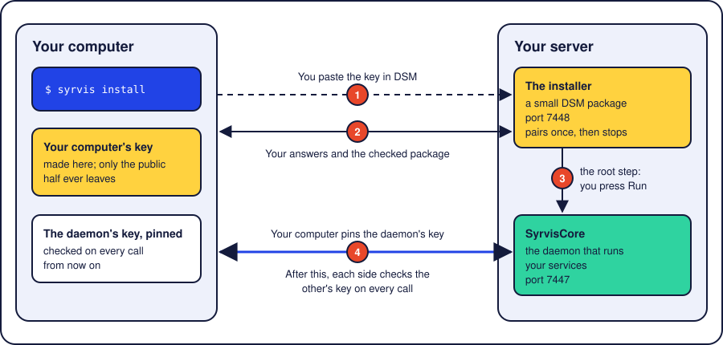

# Install: the first handshake

At the end of this page, your Synology NAS runs SyrvisCore, and your computer and the server trust each other by their keys. From then on you run the server from your computer with one command, `syrvis`. Your part is five steps: two in a terminal on your computer and three in DSM. Keep the terminal and DSM open side by side. Whenever `syrvis` waits for you, you can close the window and pick up later where you left off.

## How the two machines come to trust each other



Three parties take part. `syrvis` runs on your computer. The installer is a small DSM package that pairs your computer with the server once. SyrvisCore is the main package, and its daemon runs your services and answers `syrvis` from then on. No password is created at any point, and `syrvis` never opens a shell on the server. Only the public half of your computer's key travels, and you carry it yourself, through DSM, where you are already signed in as an administrator.

The picture numbers the four moves that pass between the machines. Your own steps, below, number five.

The names, addresses, versions and keys in this page's screens are example values. Yours will differ.

## What you need

| what | why |
|---|---|
| an x86_64 Synology whose CPU family is in the package's list | DSM refuses any other family with Error 281 and leaves nothing behind. ARM models are not supported |
| DSM 7.0-40656 or newer | the package's floor, the oldest DSM it installs on. Syrvis is measured on DSM 7.4.1; the builds between are not tested |
| a storage pool with at least one volume | Syrvis keeps its home in a shared folder on a volume |
| a DSM administrator account | for the Manual Install and the Task Scheduler task. SSH is not needed |
| Container Manager, only to run services | the install itself does not need it |
| your computer on the same network as the server | `syrvis` finds the installer on your local network |
| `syrvis` v0.1.13 on your computer | it installs the server package 2.0.0-alpha.72 |

The package's CPU families are `x86_64 avoton v1000 apollolake geminilake denverton broadwellnk r1000`. Your model's family is on the CPU line of Control Panel > Info Center > General. If yours is not in the list, ask for a build with it added before you install.

Syrvis is alpha software. Its code repositories and release pages are private for now, so today `syrvis` comes from a release page that needs read access to the syrvis organisation on GitHub.

## Your five steps

### Step 1: run `syrvis install`

On your computer, run:

```
syrvis install
```

While it reads the release, the download row shows a turning mark:

```screen
⠋ download    reading the release on github.com   0.0s
```

When the downloads are in:

```screen
syrvis install · client 0.0.0-dev · release 2.0.0

✓ name        nas (the box's own name; change with --context)
✓ download    syrvisd 2.0.0 and installer 0.1.0, checksums verified   2m8s
```

`nas` is the context: the name your computer keeps for this server. Every later command carries it as `--context nas`. `syrvis` has also made your computer's key. Its private half never leaves your computer. What DSM will ask for is your computer's key as 64 characters, and `syrvis` has written it into a copy of the installer in your Downloads folder.

**Who trusts whom:** your computer trusts the checksums published with the release and checks both downloads against them in code, so you compare no checksum by eye.

### Step 2: install the installer in DSM

`syrvis` prints what to do in DSM:

```screen
  In DSM at https://127.0.0.1:5001: Package Center > Manual Install >
  syrvis-installer-0.1.0-nas.spk (in Downloads) > Next.
  When DSM shows "your computer's key", it is filled in: press Next.
  Should the field be empty, this is the key:

      aaaaaaaaaaaaaaaaaaaaaaaaaaaaaaaaaaaaaaaaaaaaaaaaaaaaaaaaaaaaaaaa

  Leave "Run after installation" ticked, then Apply.
✓ box         127.0.0.1:7448 (the only box found; change with --pair)
! installer   waiting for the installer at 127.0.0.1:7448 to answer ⠋ 0.0s  2/5
You can close this window; this picks up here: syrvis install --context nas
```

In DSM:

1. Open Package Center and choose Manual Install.
2. Choose the installer file from your Downloads folder. Its name starts with `syrvis-installer`. Press Next.
3. DSM warns that the package is not published by Synology. That is expected, since the installer is not signed by Synology. Go on past the warning.
4. The wizard has one step, titled "Your computer's key". Its field reads: "Paste the key that syrvis install printed on your computer, whole. Run syrvis install first if you have not." The field is already filled. If it is empty, paste the 64 characters from your terminal. Press Next.
5. Leave "Run after installation" ticked, and press Apply.

The installer starts and opens port 7448 for pairing. `syrvis` finds it and connects with your computer's key:

```screen
? installer   answered at 127.0.0.1:7448; key unchecked          2m8s  2/5
```

**Who trusts whom:** the server learns which computer to trust from you, an administrator signed in to DSM, so the installer admits only the key you pasted and closes every other connection; your computer takes the installer's own key as first met, which is why the row says `key unchecked`.

### Step 3: choose the home

`syrvis` reads facts from the installer and asks the one thing only you can decide, which shared folder becomes Syrvis's home:

```screen
? Which shared folder holds syrvis's home?  3/5
    1. /volume1/h1
    2. Create a shared folder in DSM
  Or type a folder's absolute path.
✓ home        /volume1/h1                                              3/5
✓ address     127.0.0.1:50002 (the one address offered; change with --door)
✓ Docker      yes (with the Docker socket; change with --docker=false)
✓ upload      423 kB to the box, verified                             1m4s
```

Type the number of a folder, or type a folder's path. If no folder fits, the second choice points you to DSM, where you create one at Control Panel > Shared Folder > Create. The rows after the home take defaults: the address the daemon will answer on, and whether to use Docker. Each names the flag that changes it. Then `syrvis` sends the server's package to the installer.

**Who trusts whom:** the installer runs as DSM's unprivileged package user, so it can read and receive and cannot install anything, and the package that will run as root has now been checked on both machines.

### Step 4: create the Task Scheduler task

`syrvis` prints the root step:

```screen
✓ route       Task Scheduler (change with --route 3)
  As root it installs SyrvisCore, enrols this computer, and adds a boot hook
  that stays until uninstall.

  In DSM at https://127.0.0.1:5001: Control Panel > Task Scheduler > Create >
  Scheduled Task > User-defined script.
  Name it "syrvis root", user root; Schedule tab: Run on the following date,
  today's date, Do not repeat; paste this line, Save, select it, Run:

  /var/packages/syrvis-installer/target/bin/syrvis-installer enable --answers dd
dddddddddddddd

  Keep the task syrvis root: upgrade and uninstall use it again. It runs only
  when you press Run.
```

The root line is one line. This example's narrow window wraps it; copy it whole from your terminal.

In DSM:

1. Open Control Panel > Task Scheduler, and choose Create > Scheduled Task > User-defined script.
2. On the General tab, name the task `syrvis root` and set the user to root.
3. On the Schedule tab, choose "Run on the following date", pick today's date, and choose "Do not repeat".

**Who trusts whom:** nothing runs as root yet, and the task you are making runs only when you press Run.

### Step 5: paste the root line and press Run

1. On the Task Settings tab, paste the root line into the script field, whole.
2. Save.
3. In Task Scheduler's list, select "syrvis root" and press Run.

Until the task runs, the terminal waits:

```screen
! root step   waiting for the line to run on the box ⠋ 0.0s  5/5
You can close this window; this picks up here: syrvis install --context nas
```

The root line ends in a 16-character code. The code is computed from your answers: the home, the address, your computer's key and the package's checksums.

**Who trusts whom:** root learns exactly which answers to apply, because it applies only the answers that match the code and refuses any whose key is not the one you pasted in DSM.

### The handover

As root, the step installs SyrvisCore from the file that was checked, starts the daemon as a root service, and gives your computer's key the daemon's first seat. A seat is a key the daemon accepts calls from. Then it writes a handover record for `syrvis` to read.

```screen
✓ root step   ran on the box                                     1m4s  5/5
```

**Who trusts whom:** the daemon's first seat holds the key you pasted and root enrolled, and no password was created.

### The pin

`syrvis` dials the daemon at the address from your own answers, never at one the installer names. It compares the key the daemon presents with the key in the handover. When they match, `syrvis` pins the daemon: it records that key and from then on accepts only that one. Then it saves the context.

```screen
✓ paired      nas at 127.0.0.1:50002, its key is the one the installer sent
```

**Who trusts whom:** your computer now trusts the daemon by its key alone, with no certificate authority and no host name, and the installer cannot redirect it, since the key in the handover is only a hint that this check confirms.

### The close

`syrvis` prints what it installed and how long it took, then the server's status:

```screen
Installed SyrvisCore 2.0.0 on nas in 14m56s. All 5 of your steps done.
syrvis status · nas · syrvisd 2.0.0 (client 0.0.0-dev)

● healthy   nothing needs you
```

**Who trusts whom:** from here every call is mutual TLS on port 7447, where each end proves its key: your computer checks the daemon's pin, and the daemon checks your computer's seat.

## If you close the window

Your computer and the installer each keep a journal of the steps they have reached. At every wait the screen tells you that you can close the window, and names the command that picks up. Run it when you are back:

```
syrvis install --context nas
```

A run that resumes after the root step looks like this:

```screen
syrvis install · client 0.0.0-dev · release 2.0.0
Resuming at the root step; the answers are on the box.

✓ name        nas
? download    the package named, not checked against the release      2m8s
✓ box         127.0.0.1:50001
✓ installer   answered at 127.0.0.1:50001; key as first met           2m8s
✓ home        /volume1/h1
✓ address     127.0.0.1:50002
✓ Docker      yes
✓ upload      423 kB to the box, verified                             1m4s
✓ root step   ran on the box                                          1m4s
✓ paired      nas at 127.0.0.1:50002, its key is the one the installer sent
```

In this example run the package was named and not checked against the release, and its row carries a `?` to say so. The installer row reads `key as first met`, and never "verified": the first meeting is still taken on faith.

## Why a root step

DSM lets no package install another package or run as root. A root task in Task Scheduler can, so the install asks you to create one. The task is kept, because upgrade and uninstall use it again, and it runs only when you press Run.

## Why a pasted key and not a password

A DSM password in `syrvis`'s hands would give it root on the server, from a distance, by password. Syrvis refuses that design. A public key that you paste in DSM tells the server which one computer to trust, and gives away no secret.

## What is taken on faith

Your computer's first connection to the installer is taken on faith on your local network, and the screen says so with `key unchecked`. A one-time code that proves the server to your computer at that first meeting is decided and not built.

The installer pairs once and stops. To pair again, you uninstall the installer and do a fresh Manual Install. An installer that stays and opens again, a one-time code for adding a second computer, and an uninstall in one step are designed and not built.

## Once it is paired

Ask the server how it is:

```
syrvis --context nas status
```

A healthy server answers:

```screen
syrvis status · nas · syrvisd 2.0.0 (client 0.0.0-dev)

● healthy   nothing needs you
```

Three things stay on the server after the install:

- SyrvisCore, whose daemon answers `syrvis` on port 7447.
- The installer, stopped since the handover.
- The Task Scheduler task "syrvis root". Keep it: [Upgrade and uninstall](upgrade-and-uninstall.md) uses it again.

The next page is [First look](first-steps.md).
